

<a href="https://micahberkley.com"></a>

 

 

## 👋 Hey, I'm Micah

<table>
<tr>
<td width="36%" align="center" valign="middle">

 
<b>MICAH BERKLEY</b> · #TheAIMogul
</td>
<td valign="middle">

🧠 &nbsp;**Fractional Chief of AI** for businesses that know they're behind 
📍 &nbsp;Miami, FL · building in public, every day 
☁️ &nbsp;Ex-**Google Cloud** Architect and SRE · BMW · Fashion Nova 
📞 &nbsp;**50,000** voice AI calls in production for legal intake 
📈 &nbsp;**+25% profit** for a Wynwood restaurant on a free AI content stack 
🚀 &nbsp;Built [**Claresto**](https://claresto.com), [**FieldProspects**](https://fieldprospects.com), [**OnePageSocial**](https://onepagesocial.com), [**RideReady**](https://tryrideready.com) 
📰 &nbsp;Front page of the **Miami Herald** · 🏆 **Black Enterprise** Top 10 Under 35 
🎨 &nbsp;**Adobe** AI Change Maker · 🎓 **Brown** Computer Science 
🎤 &nbsp;Runs **GP Tuesdays**, free weekly AI training for Miami entrepreneurs 
⚡ &nbsp;Ask me about voice AI, agent systems, AI search, and shipping fast

</td>
</tr>
</table>

> [!TIP]
> **I'm the Fractional Chief of AI for businesses that know they're behind. I take you from watching AI happen to running on it in 90 days.**
>
> Everybody else is selling AI to people who already get it. I'm for the ones who don't. Yet.

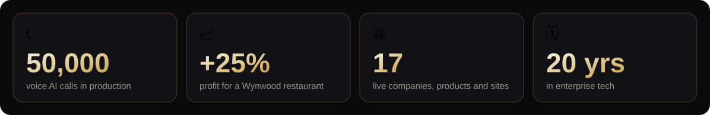

## 🏆 The receipts


## 🚀 Featured builds

<table>
<tr>
<td width="50%" valign="top">
<a href="https://claresto.com">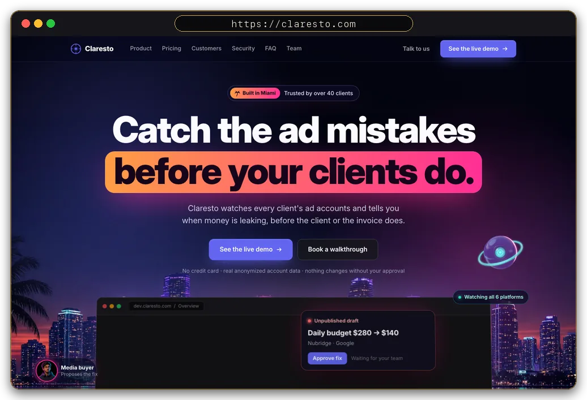</a>

### 🎯 [Claresto](https://claresto.com)
Watches every client ad account and catches the mistakes **before the client does**. The Ad Operations Command Center.

</td>
<td width="50%" valign="top">
<a href="https://fieldprospects.com">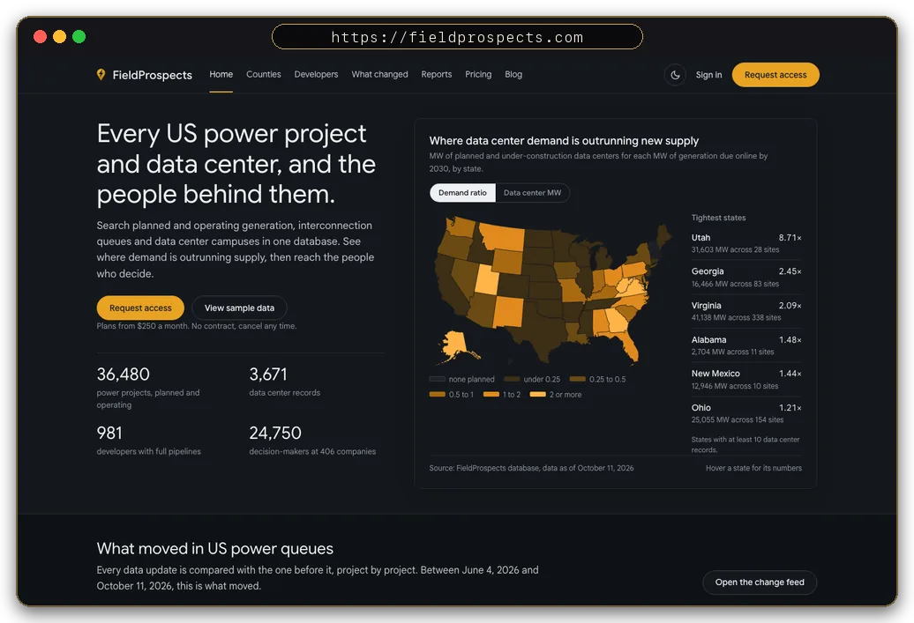</a>

### ⚡ [FieldProspects](https://fieldprospects.com)
Every US power project and data center, **and the people behind them**, in one searchable database.

</td>
</tr>
<tr>
<td width="50%" valign="top">
<a href="https://onepagesocial.com">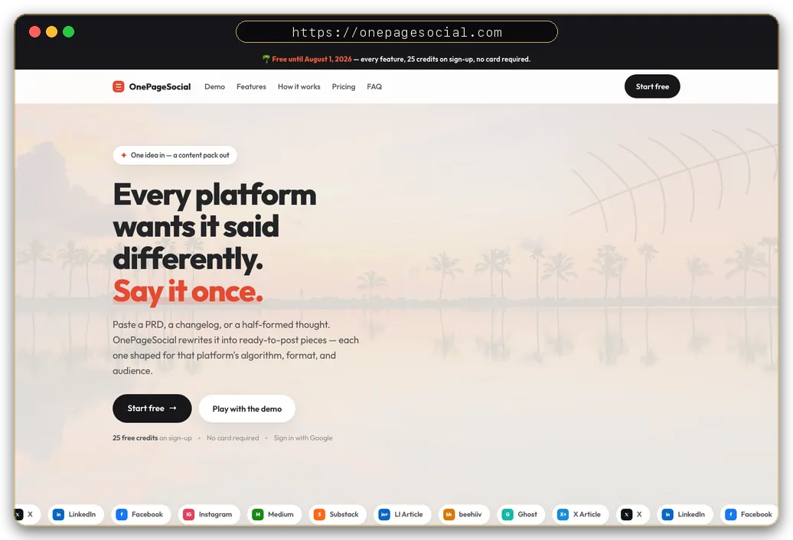</a>

### ✍️ [OnePageSocial](https://onepagesocial.com)
Paste anything and get a post that **wins on every platform**. One idea in, a content pack out.

</td>
<td width="50%" valign="top">
<a href="https://runtheeval.com">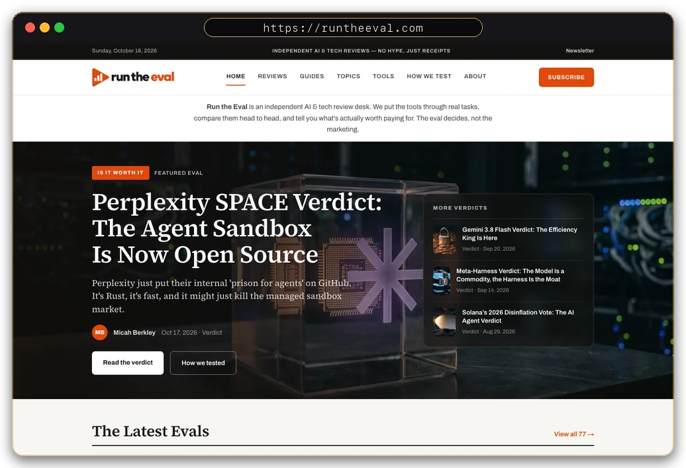</a>

### 🧪 [Run the Eval](https://runtheeval.com)
No-hype AI and tech review desk. Honest comparisons and **is-it-worth-it verdicts**.

</td>
</tr>
<tr>
<td width="50%" valign="top">
<a href="https://mailcheap.ai">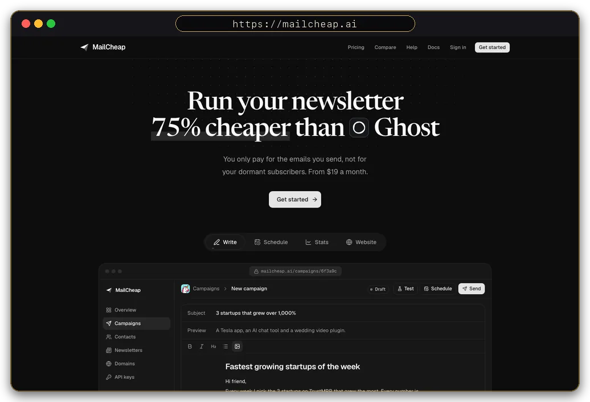</a>

### 📬 [MailCheap](https://mailcheap.ai)
Newsletters where you **pay for the emails you send**, not for dormant subscribers. Open source. Self-host it or use the cloud.

</td>
<td width="50%" valign="top">
<a href="https://blackoutbox.micahberkley.com">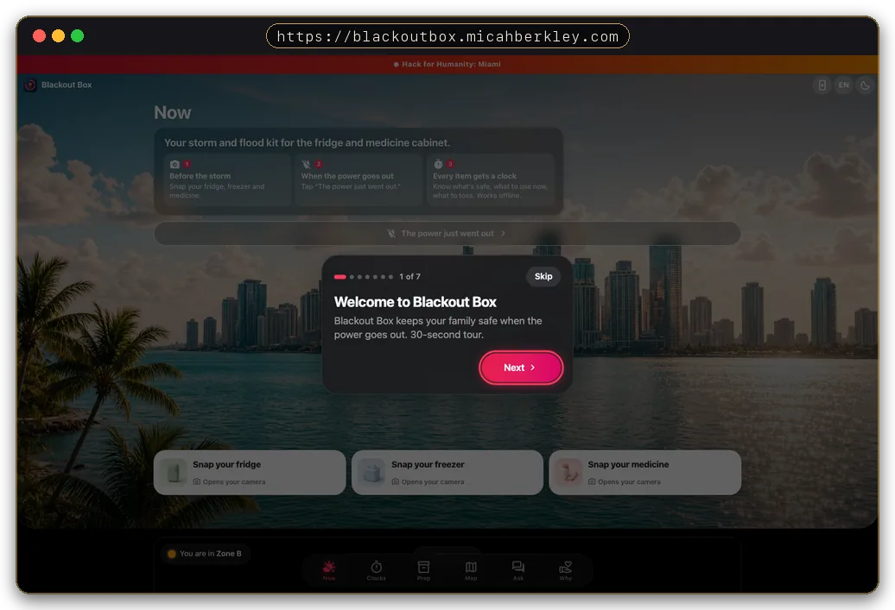</a>

### 🌀 [Blackout Box](https://blackoutbox.micahberkley.com)
Hurricane app that **keeps working when the power and signal don't**. Food and insulin countdowns, evac zones, king tides. Built for Hack for Humanity Miami 2026.

</td>
</tr>
</table>

## 🌐 Everything I run

#### 🏢 Companies

<a href="https://aisuccesspartners.com">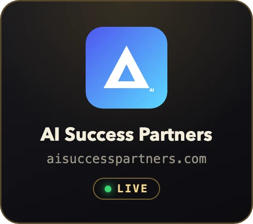</a>
<a href="https://iexcel.co">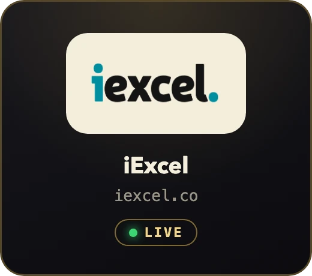</a>
<a href="https://ai4grants.com">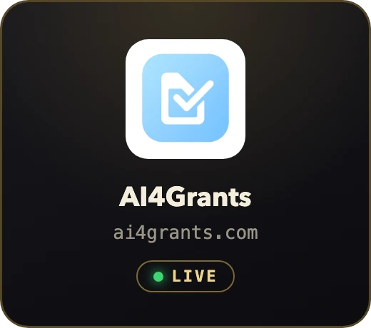</a>

#### 🛠️ Software and tools

<a href="https://claresto.com">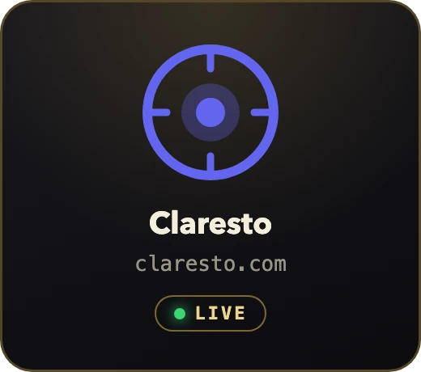</a>
<a href="https://fieldprospects.com">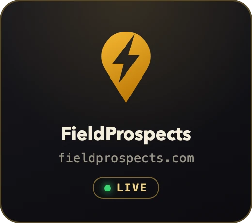</a>
<a href="https://onepagesocial.com">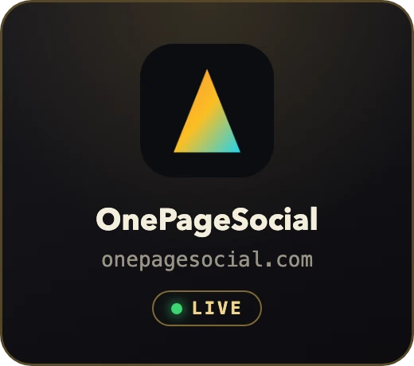</a>

<a href="https://mailforeman.com">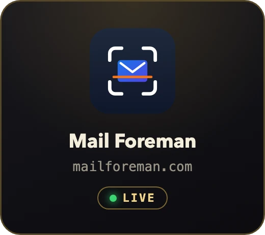</a>
<a href="https://mailcheap.ai">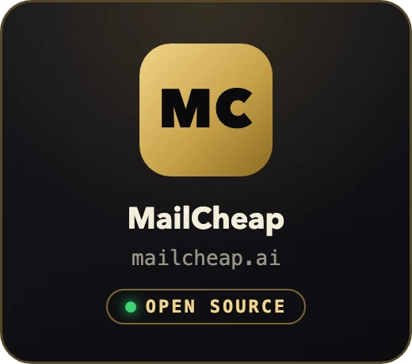</a>

<a href="https://meridian.micahberkley.com">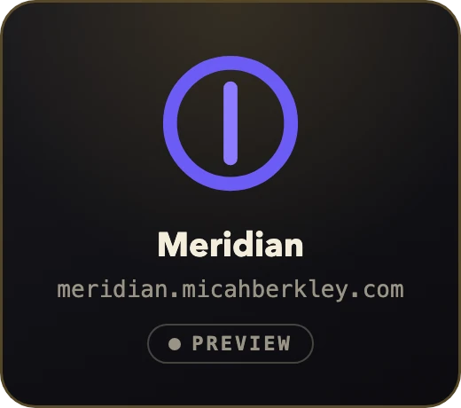</a>
<a href="https://blackoutbox.micahberkley.com">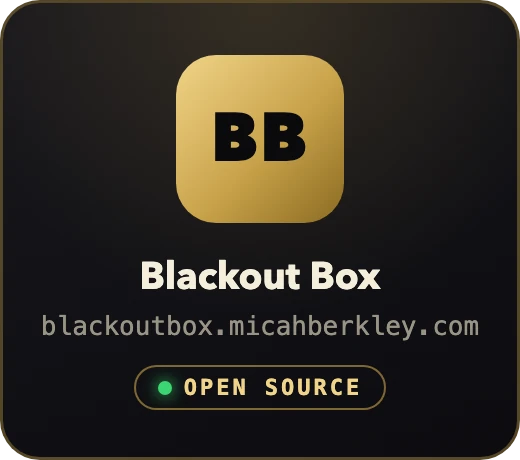</a>

#### 📰 Media, guides and community

<a href="https://runtheeval.com">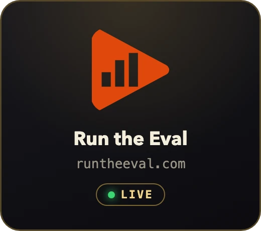</a>
<a href="https://tpssurvivalguide.com">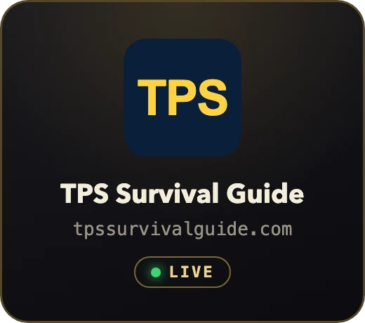</a>
<a href="https://nextstepcounseling.net">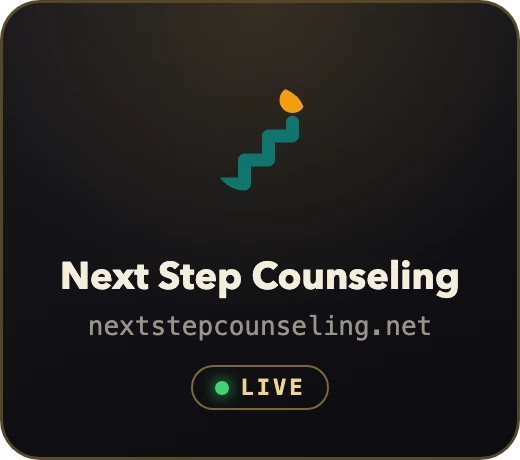</a>
<a href="https://moguldistrict.com">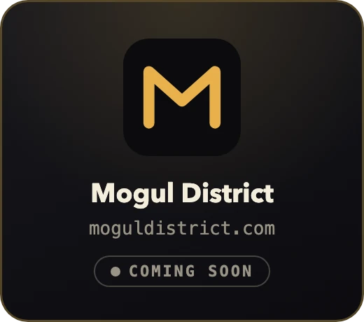</a>

#### 🌴 Miami

<a href="https://miamigtatours.com">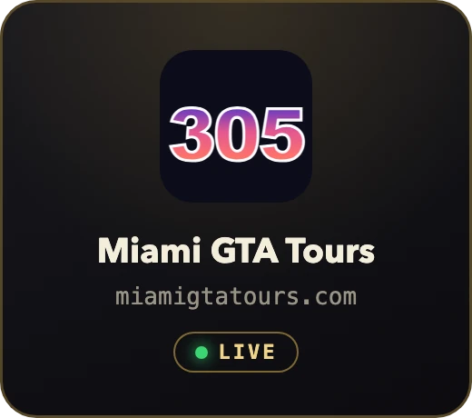</a>
<a href="https://thisisvicecity.com">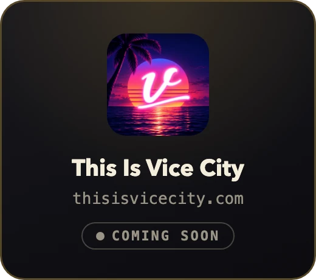</a>
<a href="https://conciergeivnurse.com">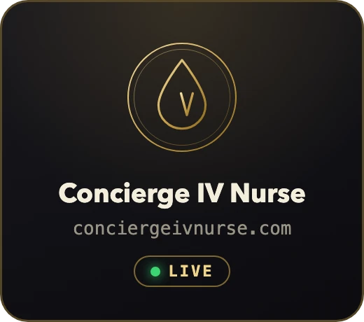</a>

## ⚙️ How I work

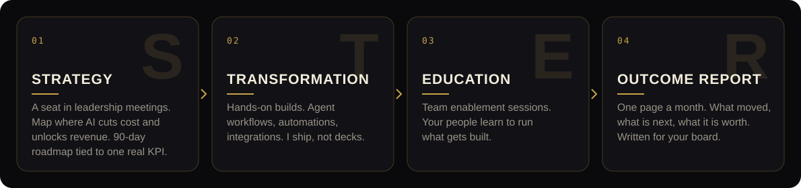

✅ &nbsp;Every engagement moves **one real number**&nbsp;&nbsp;·&nbsp;&nbsp;✅ &nbsp;I ship, not decks&nbsp;&nbsp;·&nbsp;&nbsp;✅ &nbsp;Plain language, on purpose 
❌ &nbsp;No hourly billing&nbsp;&nbsp;·&nbsp;&nbsp;❌ &nbsp;No tool reselling&nbsp;&nbsp;·&nbsp;&nbsp;❌ &nbsp;No decks that sit in a drawer

## 🧰 The stack

 
 

**🤖 The AI team I hire for every job**

I treat models like employees. Right model, right job. Whoever does the work best gets the work.

## 🐍 Always building

<picture>
  <source media="(prefers-color-scheme: dark)" srcset="https://raw.githubusercontent.com/TheAIMogul/TheAIMogul/output/snake-dark.svg" />
  <source media="(prefers-color-scheme: light)" srcset="https://raw.githubusercontent.com/TheAIMogul/TheAIMogul/output/snake.svg" />
  
</picture>

  

<a href="https://cal.com/micahberkley/30min"></a>

  

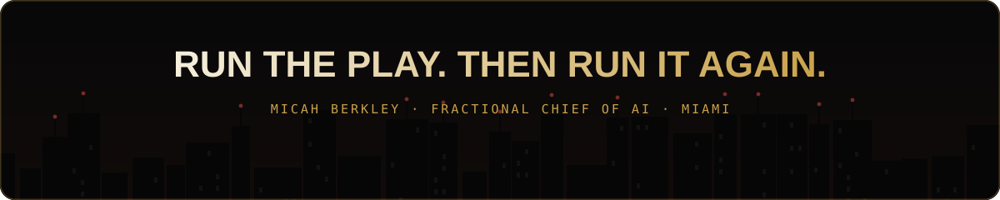

